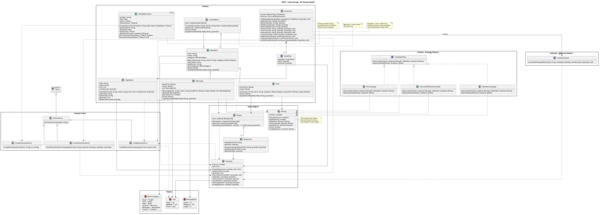

# SE237 - Lezzet Duragi

Object-Oriented Mobile Application

Maltepe University - SE237

**Scenario:** S3 - Food Ordering

## Project Description

An offline restaurant management application for menu
items, kitchen inventory, delivery orders and food preparation.

## Technologies

- TypeScript (Strict Mode)
- Ionic 8
- Angular
- Vitest
- PlantUML
- Git and GitHub

## Milestones

- [x] M1: Domain model, UML and unit tests
- [ ] M2: Application layers and Ionic screens
- [ ] Final: Complete application

## M1 - Domain Model

### Implemented Components

- Immutable value objects: Money and Quantity
- Recipe and RecipeLine
- Abstract MenuItem hierarchy
  - Dish
  - Beverage
  - ComboMenu
- Generic abstract TrackedDocument
- Ingredient and Inventory
- CampaignPolicy implementations
  - NoCampaign
  - PercentOffAboveThreshold
  - MemberCampaign
- LowStockListener
- Domain-specific errors

### Object-Oriented Design

- Encapsulation
- Abstraction
- Inheritance
- Polymorphism
- Composition
- Aggregation
- Strategy Pattern
- Observer Pattern

## UML Class Diagram

- [SVG Diagram](docs/uml/domain-model.svg)
- [PNG Diagram](docs/uml/domain-model.png)
- [PlantUML Source](docs/uml/domain-model.puml)



## Installation

```bash
npm ci
```

## Running Domain Unit Tests

```bash
npx ng test --no-watch --include="src/app/domain/**/*.spec.ts"
```

### M1 Test Results

| Metric | Result |
|---|---:|
| Test files | 13 |
| Passed tests | 123 |
| Failed tests | 0 |
| Required minimum | 10 |

## Build

```bash
npm run build
```

M1 build completed successfully.

## Current Scope

M1 focuses on the domain layer and object-oriented design.
Order management, preparation batches, persistence and
application screens will be implemented in later milestones.
